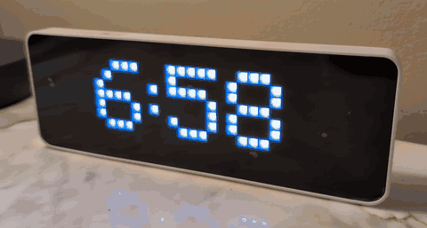

# Overhead

**A little LED clock that tells you where the plane over your house is coming from (or going), only while you can
actually hear it.**

  
   
  <a href="docs/media/overhead-teaser.mp4"><b>▶ Watch the 29-second teaser (with sound)</b></a>

  
   
  The real thing: 6:58 gives way to a plane from Appleton.

Overhead is open-source firmware for the [Ulanzi TC001](docs/hardware.md) pixel clock (an ESP32 with a 32x8 RGB LED
matrix). Live near an airport? When a plane roars over, the clock scrolls `DENVER` in Delta red, then goes back to
being a clock. No computer, server or account: it just needs Wi-Fi.

> **Status:** 0.1 is early. It runs day to day on a real TC001 under MSP's arrival path: installs and updates over
> Wi-Fi, tracks planes and shows where they came from. Testers welcome, especially near other airports.

**[Quick start guide (PDF)](docs/Overhead-Quick-Start.pdf)**

## What it does
- **Only when it's audible.** Estimates how loud each nearby plane is at your house (distance, height, aircraft size,
  takeoff vs landing, even the seconds sound takes to reach you) and lights up only while it's clearly audible.
- **Arrivals and departures.** Landing planes show where they came from; departing planes, where they're going.
- **Four display styles,** cycled with a button: `DENVER` · `DEN > MSP` · `DELTA DEN > MSP` · `DELTA 1902 DENVER > MINNEAPOLIS A321`.
- **A real clock the rest of the time,** or dark between planes if you prefer. A little jet tows each city onto
  the sign, the name always finishes before the time slides back, and the clock turns a warmer amber after sunset.
- **Milestones in gold:** the first plane of the day, every hundredth, and a new farthest-ever city.
- **Works anywhere.** Type your address once; the clock finds your nearest airport and time zone.
- **Airline colors,** and **rare aircraft** (747, A380, Dreamliner, military, helicopters, vintage) in sparkling gold.
- **Optional extras,** all off by default: inbound countdown, evening recap ("142 PLANES TODAY  FARTHEST TOKYO"),
  chime for rare planes, indoor/outdoor temperature, date, sunrise/sunset, and "landings over you today" from the wind.
- **A settings page on your phone** with a live copy of the sign, a map of every city the house has heard from,
  sample planes when you change the look, and an optional "remember this phone". Plus today's planes (kept across restarts), the hours planes usually pass over
  you, airport weather, and the clock's own health: uptime, why it last restarted, free memory.

## Get started
Everything happens over Wi-Fi: no cables, drivers or flashing tools.

1. **Put the clock on your Wi-Fi.** A new TC001 shows `192.168.4.1`: join the clock's Wi-Fi network on your phone,
   open http://192.168.4.1 and choose your home network.
2. **Install Overhead.** Download the latest [release](https://github.com/MishaTikh/overhead-clock/releases)
   (`overhead-installer.zip`), unzip it on a Windows PC on the same Wi-Fi and double-click **Install-Overhead.bat**.
   It finds the clock and installs Overhead in about 30 seconds.
   *On a Mac, Linux or phone:* open http://clock.local/update in a browser, choose `overhead-tc001-app.bin` and upload.
3. **Sign in.** Hold the clock's middle button for 3 seconds, until the display changes: it shows its settings
   address, then the password four characters at a time (left and right buttons step through). Open the address, sign in as `admin` and type your street address.

Updating later works the same way: run the installer again, or use *Update firmware* on the settings page.
Details and troubleshooting are in the [quick start guide](docs/Overhead-Quick-Start.pdf).

> Flashing the TC001 over USB doesn't work reliably from Windows (its auto-reset circuit doesn't enter flashing mode
> there), which is why installs go over Wi-Fi. On Linux or macOS, USB flashing with the merged image from the CI
> build at address `0x0` also works.

## Buttons
| Button | Press | Hold (acts while still held) |
|---|---|---|
| Left | What to show for each plane: City, Codes, Airline, Full | 1.5 s: replay recent planes |
| Middle | Clock + planes, or planes only | 3 s: show the settings address and password (left/right page through it, middle closes) |
| Right | Brightness: Auto, Low, Medium, High | |

Hold the left button while plugging the clock in to forget Wi-Fi and start setup again.

## How it works
- **Positions** come from the free [adsb.lol](https://adsb.lol) feed (about 500 requests a day per home). The clock
  predicts each plane's path between requests, polls quickly only when a plane is about to pass, slows down when the
  wind sends traffic elsewhere or in hours that are usually quiet, and goes silent during quiet hours.
- **Routes** come from community route databases (adsb.lol / VRS standing data, then adsbdb), checked against your
  airport so stale data isn't shown; unknown routes show the flight number. Near MSP you can opt in to reading the
  airport's public flight pages for exact cities (unofficial, off by default).
- **Time** comes from a configurable time server (Cloudflare's by default).
- **Loudness** uses a simple acoustic model you can tune on the settings page after listening for a few days.
- **Fail-safe:** if Wi-Fi, the internet or a service is down, it's just a clock (time kept by its battery-backed
  real-time clock), and it recovers on its own.

## Privacy and security
Outbound only: no cloud account, port forwarding or remote access. Firmware updates are accepted only from your home
network, behind the admin password. The setup hotspot and the settings page are password protected, every connection is verified HTTPS, and your exact address never goes to the
flight-data service. Prefer not to send your address anywhere? Enter coordinates instead. Details in
[SECURITY.md](SECURITY.md).

## Acceptable use
Overhead is for personal, non-commercial use at home. Each clock uses free public services directly, within their
published limits (see [THIRD_PARTY_NOTICES.md](THIRD_PARTY_NOTICES.md)). If you want to sell clocks with it, check
each provider's terms first: Open-Meteo's free tier, for one, is non-commercial. If a provider asks the project to stop
or change how it uses their service, it will.

## Building from source
See [CONTRIBUTING.md](CONTRIBUTING.md). Short version: `cd firmware && pio run -e tc001 -t upload`.

## Credits
Data: [adsb.lol](https://adsb.lol) (ODbL), VRS standing data (CC0), [adsbdb](https://www.adsbdb.com),
[OurAirports](https://ourairports.com), © [OpenStreetMap contributors](https://www.openstreetmap.org/copyright),
weather data by [Open-Meteo.com](https://open-meteo.com) (CC BY 4.0), NOAA [aviationweather.gov](https://aviationweather.gov).
This product uses the Census Bureau Data API but is not endorsed or certified by the Census Bureau.
Teaser video: footage by Joolsmagools and Sammy on [Pexels](https://www.pexels.com); music "Fluffing a Duck" by
Kevin MacLeod ([incompetech.com](https://incompetech.com)), licensed under [CC BY 4.0](https://creativecommons.org/licenses/by/4.0/).
Libraries: FastLED, ArduinoJson, WiFiManager, Arduino-ESP32. Font from Adafruit GFX. TC001 pin map from AWTRIX 3.
Full list in [THIRD_PARTY_NOTICES.md](THIRD_PARTY_NOTICES.md).

Not affiliated with Ulanzi, any airline or airport. For fun, not for navigation or safety.

## License
[MIT](LICENSE)
